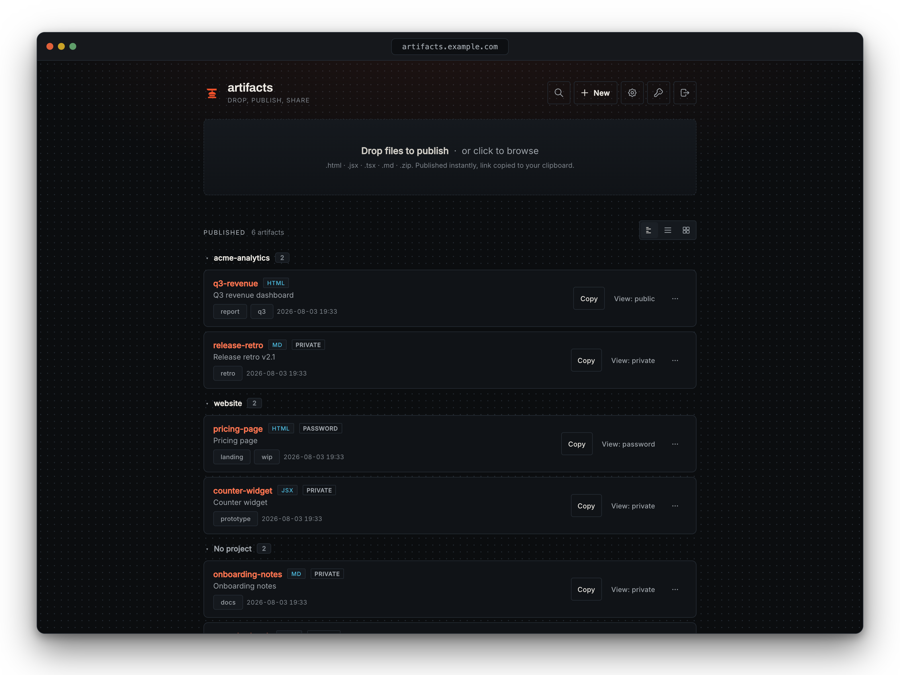
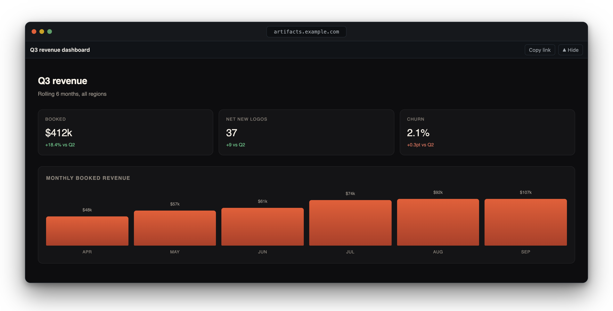
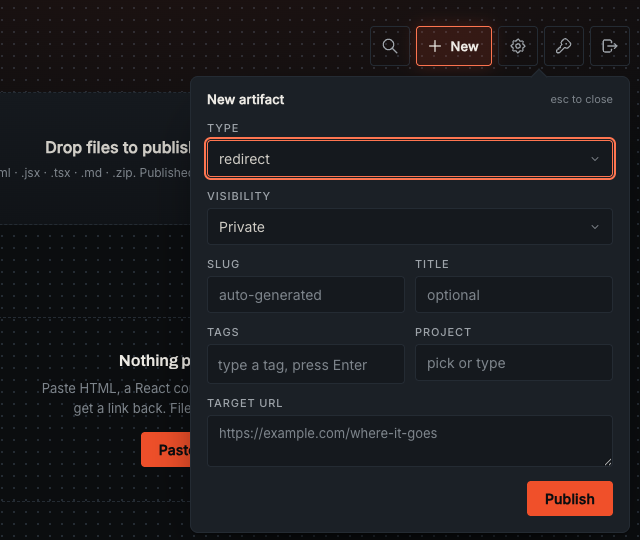
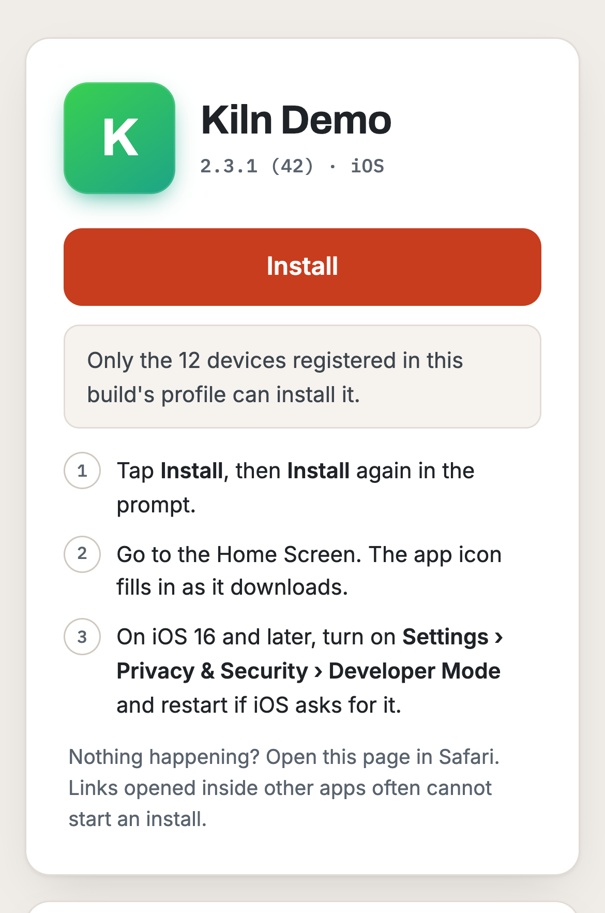
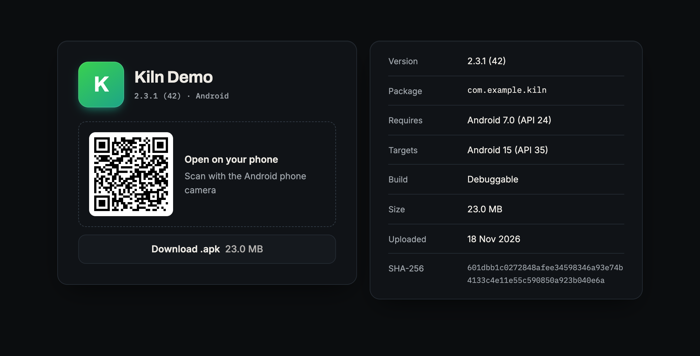
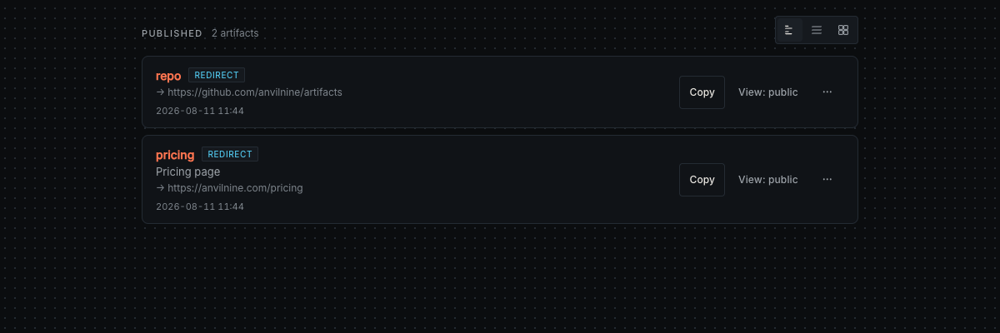

<h1 align="center">artifacts</h1>

<p align="center">
  <strong>Self-hosted, Claude-style artifact publishing</strong>
</p>

<p align="center">
  POST HTML, a React component, Markdown, a PDF, a zipped static site, or an Android or iOS build. Get back an unguessable URL on your own domain.
</p>

<p align="center">
  <a href="https://github.com/anvilnine/artifacts/actions/workflows/ci.yml"></a>
  <a href="LICENSE"></a>
  <a href="package.json">= 22"></a>
  <a href="#quick-start"></a>
  <a href="https://registry.modelcontextprotocol.io/v0.1/servers?search=io.github.anvilnine/artifacts"></a>
</p>

<p align="center">
  <a href="#features">Features</a> •
  <a href="#quick-start">Quick start</a> •
  <a href="#documentation">Docs</a> •
  <a href="docs/deploy.md">Deploy</a> •
  <a href="docs/api.md">API</a> •
  <a href="docs/cli.md">CLI</a> •
  <a href="docs/mcp.md">MCP</a> •
  <a href="#faq">FAQ</a> •
  <a href="#security">Security</a>
</p>

<p align="center">
  <br>
  <sub>The dashboard: drop files to publish, group by project, copy a link.</sub>
</p>

---

## About

AI assistants produce a lot of shareable output: dashboards, prototypes, reports, small apps. Claude's hosted artifacts work well, but the URLs live on someone else's infrastructure. This is the self-hosted version. You POST content, it serves the rendered result at an unguessable URL on a domain you control.

It runs as one container with a single admin account and, by default, no database. Each artifact is a directory of plain files under `/data`, so backing up that directory backs up everything. On hosts that wipe local disk on restart, point it at durable external storage instead (an S3-compatible bucket, a git remote, or Postgres) by setting `STORAGE_BACKEND`. See [deploying](docs/deploy.md#storage-backends).

## Features

- **Content types.** HTML, JSX/TSX (a single React component, no build step), Markdown, BPMN 2.0 process maps, PDF, zipped static sites, and APK, AAB and IPA app builds.
- **Agent-native, human-friendly.** A built-in MCP server lets Claude Code, Codex, or any MCP client publish with one tool call. Humans get a drag-and-drop web UI at `/` (behind an admin login) and a [CLI](docs/cli.md).
- **Two-tier auth.** An admin logs into the dashboard with a password; CLI and MCP carry scoped, revocable [API keys](docs/auth.md) (`read` / `publish` / `full`) with optional expiry, so you never share one master secret.
- **Private by default, with per-artifact visibility.** A new artifact is `private`, shared through a signed capability link (`?k=…`) you can rotate to revoke. Switch any artifact to `public` (anyone with the bare link) or password-protected. Nothing is discoverable by default: unguessable slugs, `noindex` everywhere. See [visibility](docs/api.md#visibility).
- **Optional viewer frame.** A slim top toolbar (title, copy link, hide) like Claude, Gemini, and ChatGPT artifacts. Toggle it globally in Settings or per artifact; `?raw=1` serves the bare content. Redirects and app install pages are never framed.
- **Markdown render settings.** Pick the reading font, content width, base font size, and starting theme for every Markdown artifact in Settings. Markdown renders from its source on each view, so a change shows on existing artifacts too. Framed Markdown gets a navbar button that cycles Auto, Light, and Dark for that reader. A fenced `mermaid` code block is drawn as a diagram that follows the theme. See [docs/formats.md](docs/formats.md#markdown-render-settings).
- **BPMN process maps.** Publish a BPMN 2.0 file and it gets a diagram viewer with pan, zoom, and SVG or `.bpmn` download. The XML is checked on publish, and a file with no diagram layout gets one drawn for it, pools and lanes included, so an agent can write the process and leave the coordinates to the server. See [docs/formats.md](docs/formats.md#bpmn-process-maps).
- **PDF hosting.** Publish a PDF and it gets a viewer page plus a direct-download link. Three per-artifact viewer modes (standard, presentation, minimal) and a download toggle that removes the viewer's buttons. The toggle is a convenience, not protection: the file's URL still answers with the bytes. See [docs/formats.md](docs/formats.md#pdf).
- **Over-the-air app installs.** Drop an `.apk`, `.aab` or `.ipa` and it gets an install page. An iPhone or iPad gets an Install button, an Android phone gets the download and the steps after it, and a computer gets a QR code to move the tester to their phone. The page shows the version, build number, bundle or package id, minimum OS and SHA-256, all read from the build at upload. For an IPA it also reads the provisioning profile: Ad Hoc or Development with its device count, Enterprise, or App Store. A build that cannot install from a link (signed for the App Store, an expired profile, or a server on plain HTTP) says why instead of showing a button that fails. Upload a new build to the same slug and testers keep one link. An `.aab` is a Play Console upload, so its page says so and shows the `bundletool` commands. See [docs/formats.md](docs/formats.md#app-builds-apk-aab-ipa).
- **Redirects.** `type: "redirect"` turns a slug into a short link that answers an HTTP 301 at the server, where other hosts fall back to a JavaScript bounce. The target must be an absolute http(s) URL and cannot carry credentials, and the response is uncacheable, so repointing the slug takes effect on the next visit. Repoint one from the row menu in the dashboard, or with a `PUT`. Read the cost of running an open redirector on your domain first: [docs/formats.md](docs/formats.md#redirects).
- **Embeddable.** A public artifact drops into any page as one `<iframe>`. The row menu writes the tag for you, pointing at `?raw=1` so the frame holds the artifact and not a second toolbar. Private and password-protected artifacts stay unembeddable on purpose, and the unlock prompt refuses to be framed at all. See [docs/embedding.md](docs/embedding.md).
- **QR code per artifact.** Every artifact has a QR of its permanent URL, from the row menu in the dashboard, `GET /api/artifacts/:slug/qr`, or `artifacts qr <slug>`. SVG or PNG, generated in-process: no QR library, no third-party image service, nothing about your artifacts leaves the box. See [the API reference](docs/api.md).
- **Organize by project.** Group artifacts built for the same project into collapsible sections, with a search box across project, title, slug, tags, and a redirect's target. Tags stay for cross-cutting labels.
- **Lifecycle controls.** Custom slugs, rename, tags, disable without deleting, auto-expire, delete.
- **Abuse-resistant.** Login and unlock endpoints are rate-limited per client IP (failures only), and password hashing runs off the event loop, so a burst of guesses slows those two routes instead of stalling the server. Set `TRUST_PROXY` for the real client IP behind Cloudflare or a reverse proxy. See [deploying](docs/deploy.md#rate-limiting-and-the-edge).

## Ways to publish

| From | How | Credential |
|---|---|---|
| A browser | Drop files on the dashboard at `/`, or paste into **New** | Admin login |
| The terminal | `artifacts publish page.html`, `artifacts publish app.ipa` or `artifacts deploy ./dist` ([CLI](docs/cli.md)) | Scoped API key |
| Any HTTP client | `POST /api/artifacts`, or `POST /api/artifacts/app` with a build file ([REST API](docs/api.md)) | Scoped API key |
| An agent | `publish_artifact` over the built-in [MCP server](docs/mcp.md) | Scoped API key |

## Screenshots

<table>
  <tr>
    <td width="50%" valign="top">
      <br>
      <sub>A published artifact with the optional viewer frame: title, copy link, hide.</sub>
    </td>
    <td width="50%" valign="top">
      <br>
      <sub>The <b>New</b> form: type, visibility, slug, tags and project in one place.</sub>
    </td>
  </tr>
  <tr>
    <td width="50%" valign="top">
      <br>
      <sub>An IPA's install page on an iPhone: one tap, then what to do next for this build's profile.</sub>
    </td>
    <td width="50%" valign="top">
      <br>
      <sub>The same kind of page on a computer: a QR code for the phone, and what was read from the build.</sub>
    </td>
  </tr>
  <tr>
    <td colspan="2">
      <br>
      <sub>Redirects in the list show where they point.</sub>
    </td>
  </tr>
</table>

## Quick start

### 1. Run it

Clone, configure, start:

```bash
git clone https://github.com/anvilnine/artifacts && cd artifacts
cp .env.example .env   # set ARTIFACTS_API_KEY (openssl rand -hex 32) and BASE_URL
docker compose up -d
```

Or skip the clone and run the image directly:

```bash
docker run -d -p 3000:3000 -v artifacts-data:/data \
  -e ARTIFACTS_API_KEY=$(openssl rand -hex 32) \
  -e BASE_URL=https://artifacts.example.com \
  ghcr.io/anvilnine/artifacts:latest
```

### 2. Publish something


```bash
curl -s -X POST https://artifacts.example.com/api/artifacts \
  -H "Authorization: Bearer $ARTIFACTS_API_KEY" \
  -H "Content-Type: application/json" \
  -d '{"content": "<h1>hello</h1>", "type": "html", "slug": "hello", "tags": ["demo"]}'
# {"slug":"hello","url":"https://artifacts.example.com/a/hello"}
```

### 3. Let an agent publish

Add the MCP server to Claude Code. Codex and other clients are in [docs/mcp.md](docs/mcp.md).

```bash
claude mcp add --transport http artifacts https://artifacts.example.com/mcp \
  --header "Authorization: Bearer ${ARTIFACTS_API_KEY}" --scope user
```

## Documentation

| I want to… | Read |
|---|---|
| Deploy it (Docker, compose, Coolify, bare node, env vars) | [docs/deploy.md](docs/deploy.md) |
| Keep artifacts in a private GitHub repo | [docs/storage-github.md](docs/storage-github.md) |
| Keep artifacts in a Forgejo or Gitea repo | [docs/storage-forgejo.md](docs/storage-forgejo.md) |
| Run on Coolify with MinIO as durable storage | [docs/coolify-minio.md](docs/coolify-minio.md) |
| Publish preview deploys from GitHub Actions | [docs/ci-preview.md](docs/ci-preview.md) |
| Use the REST API (incl. zip sites and tags) | [docs/api.md](docs/api.md) |
| Publish from the terminal | [docs/cli.md](docs/cli.md) |
| Hook up Claude Code / Codex / any agent | [docs/mcp.md](docs/mcp.md) |
| Set up login + scoped API keys | [docs/auth.md](docs/auth.md) |
| Understand JSX/TSX rendering + zip validation | [docs/formats.md](docs/formats.md) |
| Put an artifact inside another page | [docs/embedding.md](docs/embedding.md) |
| Hand testers an APK or IPA to install from a link | [docs/formats.md](docs/formats.md#app-builds-apk-aab-ipa) |

## Storage

One container, a single admin account, and no database by default. Pick a backend with `STORAGE_BACKEND`:

| Backend | Where artifacts live | Guide |
|---|---|---|
| `local` (default) | Plain files under `DATA_DIR` (`/data`) | [Deploying](docs/deploy.md#storage-backends) |
| `s3` | Any S3-compatible bucket: R2, B2, MinIO, Spaces, Wasabi, GCS interop | [S3](docs/deploy.md#s3-and-s3-compatible-r2-b2-minio-spaces-wasabi-gcs-interop), [Coolify + MinIO](docs/coolify-minio.md) |
| `git` | A git remote, one commit per change | [GitHub](docs/storage-github.md), [Forgejo](docs/storage-forgejo.md) |
| `postgres` | A Postgres table | [Postgres](docs/deploy.md#postgres) |
| `sqlite` | One SQLite file, through Node's built-in `node:sqlite` | [SQLite](docs/deploy.md#sqlite) |

The optional backends load their dependency only when selected.

## FAQ

<details>
<summary><b>How do I back it up?</b></summary>
<br>
On the default <code>local</code> backend every artifact is a directory of plain files under <code>/data</code>. Back up that directory and you have backed up everything. On the other backends, back up the bucket, repo or database.
</details>

<details>
<summary><b>My host wipes local disk on restart. Will I lose artifacts?</b></summary>
<br>
On the <code>local</code> backend, yes. Fly Machines without a volume, Cloud Run and Heroku dynos all start fresh. Set <code>STORAGE_BACKEND</code> to <code>s3</code>, <code>git</code> or <code>postgres</code> and the container holds no state. See <a href="docs/deploy.md#storage-backends">storage backends</a>.
</details>

<details>
<summary><b>Who can see a new artifact?</b></summary>
<br>
Only people holding its capability link (<code>?k=…</code>). New artifacts are <code>private</code> unless you set <code>DEFAULT_VISIBILITY=public</code>. Rotate the link to revoke every copy already handed out (<code>artifacts rotate &lt;slug&gt;</code>). Links expire after <code>CAP_TOKEN_TTL_DAYS</code>, 30 by default. See <a href="docs/api.md#visibility">visibility</a>.
</details>

<details>
<summary><b>Can I embed an artifact in another site?</b></summary>
<br>
A <code>public</code> one, yes, as an <code>&lt;iframe&gt;</code> pointing at <code>/a/&lt;slug&gt;?raw=1</code>. A private artifact shows as an empty frame and the password prompt refuses to be framed. See <a href="docs/embedding.md">embedding</a>.
</details>

<details>
<summary><b>Can CI publish a preview of every pull request?</b></summary>
<br>
Yes. Give CI its own scoped key, build the site for its subpath, and run <code>artifacts deploy</code>. Both patterns (one stable preview, or one per pull request) are in <a href="docs/ci-preview.md">docs/ci-preview.md</a>.
</details>

<details>
<summary><b>Can testers install my iOS or Android build from the link?</b></summary>
<br>
Yes, for an <code>.apk</code>, and for an <code>.ipa</code> signed with an Ad Hoc, Development or Enterprise profile. iOS only installs from a link served over HTTPS, and an Ad Hoc or Development build only installs on the devices listed in its profile. An App Store build and an <code>.aab</code> cannot install from any link, and their pages say so. Builds up to 200 MB by default (<code>APP_MAX_MB</code>). See <a href="docs/formats.md#app-builds-apk-aab-ipa">app builds</a>.
</details>

<details>
<summary><b>It sits behind Cloudflare. Does rate limiting still see the real client IP?</b></summary>
<br>
Set <code>TRUST_PROXY=cloudflare</code> to read <code>CF-Connecting-IP</code>, or <code>TRUST_PROXY=xff</code> behind another reverse proxy. See <a href="docs/deploy.md#rate-limiting-and-the-edge">rate limiting and the edge</a>.
</details>

## Development

No build step. Node ≥ 22.

```bash
npm install
cp .env.example .env   # any ARTIFACTS_API_KEY works locally, e.g. "test"
npm run dev
# UI at http://localhost:3000
```

The end-to-end suite is one shell script:

```bash
bash .github/workflows/smoke.sh http://localhost:3000 <your-key>
```

A few cases cannot be reached over HTTP, such as a hand-edited `auth.json`. Those run as unit
tests on node's built-in runner, no server needed:

```bash
npm test
```

That covers the dashboard too. `dashboard-check.mjs` fetches `/`, parses the inline script in
`public/index.html`, and checks that every element the script grabs by id is still in the markup.
It runs no browser, so it catches a syntax error or a deleted element but not a runtime error.

PRs welcome. See [CONTRIBUTING.md](CONTRIBUTING.md).

## Hosted version

Self-hosting is the product, and the open source version stays complete. If you would rather not run a server, [Anvil Nine](https://anvilnine.com) is building a managed version: same publishing flow, custom domains, backups handled for you. A waitlist page opens with the first cloud announcement; watch this repo's releases until then.

## Security

Uploaded HTML runs in the browser. That is the whole point, so the model is built to contain it:

- **Serve artifacts from their own origin.** Point artifact URLs at a domain that hosts nothing else, so a published page can never touch the dashboard's session cookie.
- **Writes need a scoped API key.** Publishing carries a bearer key; the admin dashboard uses a separate HttpOnly, SameSite=Strict session cookie.
- **Reads rely on unguessable slugs.** Public artifacts are reachable by anyone with the link and carry `noindex`, but there is no listing to browse. Don't publish secrets.
- **Credential routes are throttled.** Login and unlock rate-limit per client IP and hash passwords off the event loop. A caller below `publish` scope gets a 256 kB body parser instead of the 10 MB one, and a cap of 20 large bodies a minute per client IP, both checked before the body is parsed. Put a CDN or edge limiter in front for volumetric attacks.

Full threat model in [SECURITY.md](SECURITY.md).

## Acknowledgements

This project stands on other people's open source. All of the following are MIT licensed.

**Runtime**
- [express](https://github.com/expressjs/express) for the HTTP server
- [marked](https://github.com/markedjs/marked) for Markdown rendering
- [bpmn-moddle](https://github.com/bpmn-io/bpmn-moddle) for reading and checking BPMN 2.0 files
- [nanoid](https://github.com/ai/nanoid) for unguessable slug generation
- [adm-zip](https://github.com/cthackers/adm-zip) for zip site extraction
- [zod](https://github.com/colinhacks/zod) for request validation
- [@modelcontextprotocol/sdk](https://github.com/modelcontextprotocol/typescript-sdk) for the built-in MCP server

**Optional storage backends** (loaded only when selected)
- [aws4fetch](https://github.com/mhart/aws4fetch) for S3-compatible signing
- [isomorphic-git](https://github.com/isomorphic-git/isomorphic-git) for the git backend
- [pg](https://github.com/brianc/node-postgres) for the Postgres backend

The SQLite backend uses Node's built-in `node:sqlite` (no dependency).

**Web UI**
- [Tabler Icons](https://tabler.io/icons) for the app-bar icons (search, new, settings, lock), inlined as SVG

## License

[MIT](LICENSE) © 2026 Zonily Jame

<p align="center">
  <sub>One container. Plain files by default; pluggable S3 / git / Postgres / SQLite storage.</sub>
</p>
